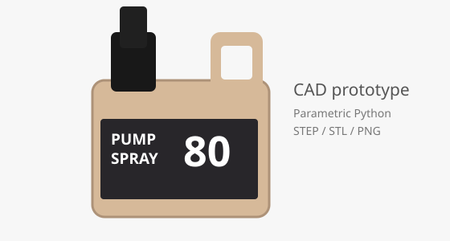

# ISE MOUNT Pump Spray 80 ml — parametric CAD reconstruction

Parametric visual reconstruction of the 80 ml spray bottle. The current model includes a drafted shoulder, a tapered through-handle, a recessed foot, a ribbed cap and a raised rear capacity mark. Dimensions are estimates using a nominal 10 mm mat pitch.



The sketch is illustrative; **real CAD renders are created by GitHub Actions** and available as build artifacts.

## Build

Requires Python 3.11+, OpenSCAD and Xvfb (Linux):

```bash
sudo apt-get install -y openscad xvfb fonts-dejavu-core
python -m pip install -r requirements.txt
bash scripts/build.sh
```

Outputs: `out/body.stl`, `out/pump.stl`, `out/silhouette.stl`, `out/spray-bottle.step`, six PNG camera renders and photo-silhouette metrics `out/comparison.json`. GitHub Actions repeats this build on push.

## Source structure

- `src/model.py`: parametric CadQuery body, through-handle, spray head, sticker and letters (all dimensions in mm, estimates).
- `src/render.py`: six headless OpenSCAD camera previews.
- `src/compare.py`: GrabCut on original photos when available; otherwise compare against saved reference silhouette contours.
- `refs/silhouettes.json`: contours **extracted from the user's actual photographs**, stored as text to make CI reproducible without multi-megabyte photos.
- `src/grid_scale.py`: experimental grid pitch estimation, not a metric camera calibration.
- `tests/`: 4 geometry/raster comparison smoke tests.

Original high-resolution images are in the separately delivered project archive, and can be placed under `refs/photos/`. They are deliberately not committed to this **public** GitHub repository. The vector silhouettes preserve privacy and provide lightweight shape reference for CI.

## Photo ↔ render QA

The pipeline compares normalized silhouettes with IoU (higher is better) and symmetric contour Chamfer distance (lower is better). Reference contours were obtained using OpenCV GrabCut from three user-provided photos, then simplified at 2 pixels tolerance. With actual photos present, the pipeline recomputes segmentation from them instead.

Preliminary full-photo baseline: front **0.713**, rear **0.644**, side **0.843** IoU. These are uncalibrated perspectives; shape similarity is not dimensional accuracy. **No strict IoU quality gate** until the camera pose is calibrated.

For an accurate comparison: measure some bottle dimensions, place ChArUco or AprilTag markers by it, calibrate camera intrinsics/pose, render with matching projection, optimize camera/object pose, evaluate keypoint reprojection errors and silhouette differences in a known scale.

## Printability and safety

Main body and pump are separate visual solids, not a usable threaded cap or sealed reservoir. Do not use as a fluid container for alcohol/fuel or print a fitted part without physical measurements.

## Perspective visual validation

The upright front, rear and side photos use separately fitted mat and bottle
poses and a shared focal length. The manifest identifies four approximate
corners of a known grid rectangle in each image, excludes the bottle and
shadow from grid detection, and records the image positions of the bottom
edge and pump top. The program refines grid intersections from the JPEGs,
fits a pinhole camera, and checks reprojection on held-out intersections.
The bottom edge sets XY and yaw using the CAD footprint for the offset
from edge to center. The optional front-up photo uses the shared focal
length, a separate mat pose, and the front bottom edge at a height estimated
from the bottle depth. The annotated pump top is a
separate reprojection check. The CAD dimensions are held fixed across views.

```bash
python src/model.py --out out
python src/visual_validate.py --photos refs/photos --cad out --out out/visual
# Also compare the front-up photo (1000048546.jpg).
python src/visual_validate.py --photos refs/photos --cad out --out out/visual --include-flat
```

The report `out/visual/comparison.html` is self-contained and shows the
photo, perspective CAD render, overlay, pixel differences and grid
reprojection for each view. The output also includes a camera/pose JSON,
full-frame photo masks, CAD part IDs (body including handle, pump, label and
lettering), and optical-axis depth in millimeters. The renderer uses a CPU
triangle rasterizer with perspective depth and flat shading.

The supplied manifest assumes 10 mm per grid cell, square pixels, a centered
principal point and zero lens distortion. Measure the mat's pitch and pass
`--grid-pitch-mm <measured spacing>` to override the assumption. Pixel errors
also depend on the visible bottom edge approximating the contact edge and on
the photo segmentation. Use `--min-iou <threshold>` to gate each view after
supplying the measured pitch. Missing photos and failed grid reprojection
are validation errors.

The push/PR workflow checks CAD outputs and tests the perspective math with
synthetic data. The separate **Visual Validation** workflow runs on demand.
Set the repository secret `CAD_PHOTOS_ZIP_URL` to an HTTPS URL for a private
ZIP containing the three original JPEGs at its root, then dispatch the
workflow with the measured grid pitch and desired minimum IoU. Only the
numerical comparison JSON is uploaded to GitHub Actions, since the report
contains the photos. Run locally to view the overlays.
